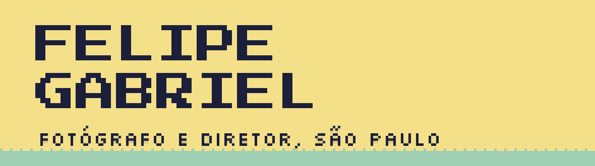

# Felipe Gabriel

**Fotógrafo e diretor em São Paulo. Toco a produtora MIMESE, faço ferramentas e me aventuro com IA na Quadro Tec.**

Cobri os principais festivais de música do Brasil, como Lollapalooza, Rock in Rio, Popload, Bananada e Red Bull Music Academy, e fotografei as festas da cena eletrônica de São Paulo, como ODD, Capslock, Gop Tun e Mareh. Atendi marcas como Chivas, Red Bull, Hering, Mitsubishi, Folha de S.Paulo e UOL. De tanto repetir o mesmo trabalho na edição, comecei a escrever as ferramentas que eu queria usar.

---

## O que eu faço

### MIMESE

Produtora de vídeos curtos com a linguagem nativa do digital, do roteiro à entrega, pra marcas.

### Quadro Tec

Onde eu e o [Gabriel Cabral](https://github.com/gabrielccabral) fazemos ferramentas e produtos digitais com IA: apps, automações e o que mais der vontade de tirar do papel.

### [motion-eleicao](https://github.com/fgf0t/motion-eleicao)

Uma skill gratuita pro Claude Code e o Codex que faz vídeo motion 9:16 sobre a eleição a partir de uma pauta: fonte em todo fato, voz grátis, imagens livres e animação feita em código.

### [FG Essencial](https://fgf0t.com)

10 presets de Lightroom que uso nos meus trabalhos, com as aulas do processo que faz eles funcionarem em fotos diferentes.

---

## Onde me achar

- Site &nbsp;&nbsp;[fgf0t.com](https://fgf0t.com)
- Instagram &nbsp;&nbsp;[@fgf0t](https://instagram.com/fgf0t)
- E-mail &nbsp;&nbsp;fg@fgf0t.com

---

> A maior parte dos meus repositórios é privada, porque é trabalho de cliente ou produto em andamento. O gráfico de contribuições aí em cima mostra o ritmo de verdade.
